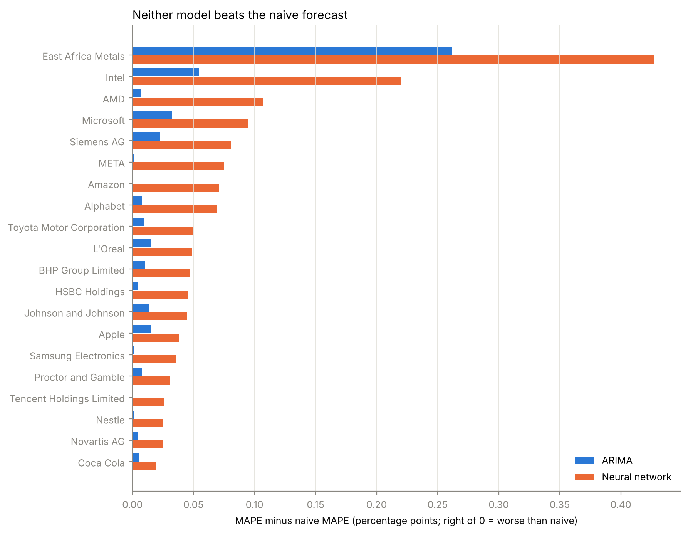
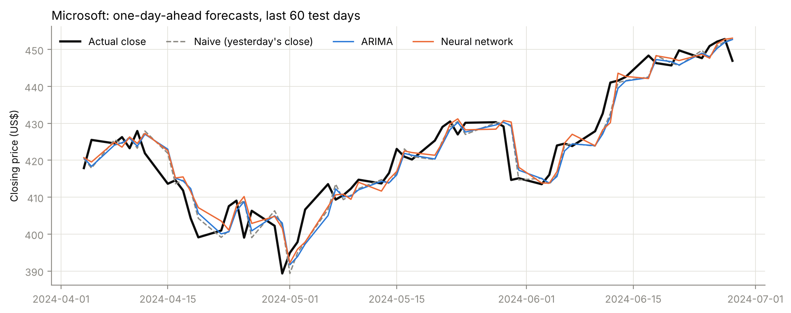

# Stock Price Forecasting: ARIMA vs Neural Network

**Can ARIMA or a neural network predict tomorrow's closing price better than simply repeating today's?**

For 20 large companies over 10 years of daily prices: **no.** Once every model is restricted to information available the day before, the naive forecast ("tomorrow = today") is the most accurate, and both models call the direction of moves about as often as a coin flip.



## Results

One-day-ahead forecasts on the test period (late December 2021 – June 2024, about 629 trading days per company):

| Model | Average error (MAPE) | Direction called correctly | Beats naive |
|---|---|---|---|
| Naive (yesterday's close) | **1.51%** | – | – |
| ARIMA(p, 1, q) on log prices | 1.54% | 50.1% | 0 of 20 companies |
| Neural network (40 hidden nodes) on past returns | 1.59% | 50.8% | 0 of 20 companies |

A July 2024 check on unseen data gives the same order (naive 1.46%, ARIMA 1.47%, neural network 1.50%).

The forecasts look accurate on a chart, but they are essentially the actual price shifted by one day:



## Why the original version looked much better

This project began as a group capstone in MATLAB (see [`original_matlab/`](original_matlab/)), where the neural network appeared extremely accurate. Rebuilding it showed why: its inputs were **the same day's** Open, High, Low, Volume and **Close**, and it was asked to predict that same day's Close. The scaling also used the whole dataset, test years included.

Reproducing that setup in the notebook drops the error to 0.91%, "beating" naive for 19 of 20 companies, because the answer is one of the inputs. With only past information, that advantage disappears.

## Method

- **Data:** daily prices for 20 companies from Yahoo Finance, July 2014 – June 2024 (`data/`), plus July 2024 for validation (`validation/`).
- **Split:** first 75% of days for training, last 25% for testing, in date order. Scalers are fitted on training days only.
- **Naive baseline:** tomorrow's close = today's close.
- **ARIMA:** ARIMA(p, 1, q) on log prices, p and q from 0 to 2 chosen by AIC on training data, then one-step-ahead forecasts with parameters fixed.
- **Neural network:** scikit-learn `MLPRegressor`, one hidden layer of 40 nodes, Adam, early stopping. Inputs are the previous 10 daily log returns; the output is the next day's return, converted back to a price.
- **Metrics:** mean absolute percentage error (prices are in different currencies and scales), and the share of days the up/down move was called correctly.

## Data issues found

- **Two validation files are a different listing from their training files.** Siemens drops 74% and L'Oreal jumps 355% overnight between the two files, so they are excluded from the July 2024 check.
- **East Africa Metals** is very thinly traded: its price does not move on 39% of days.

## Run it

```bash
pip install -r requirements.txt
jupyter notebook stock_forecasting.ipynb
```

The full notebook runs in under a minute.

## Project structure

```
├── stock_forecasting.ipynb   # Full analysis (Python)
├── data/                     # Daily prices, July 2014 – June 2024, 20 companies
├── validation/               # July 2024
├── results/                  # Charts used in this README
├── original_matlab/          # Original group version: MATLAB code, results, report
└── requirements.txt
```

## Credits

The original version was a group project for MTH 1060 (Analytical Computational Foundation) at USIU-Africa, Group 5: Misati Nyambane, Hoziyana Rachael and Betelhem Kebede, built in MATLAB. The Python analysis in this repository is my independent re-implementation.

**Author:** Betelhem Getachew Kebede, Data Science & Analytics, USIU-Africa
